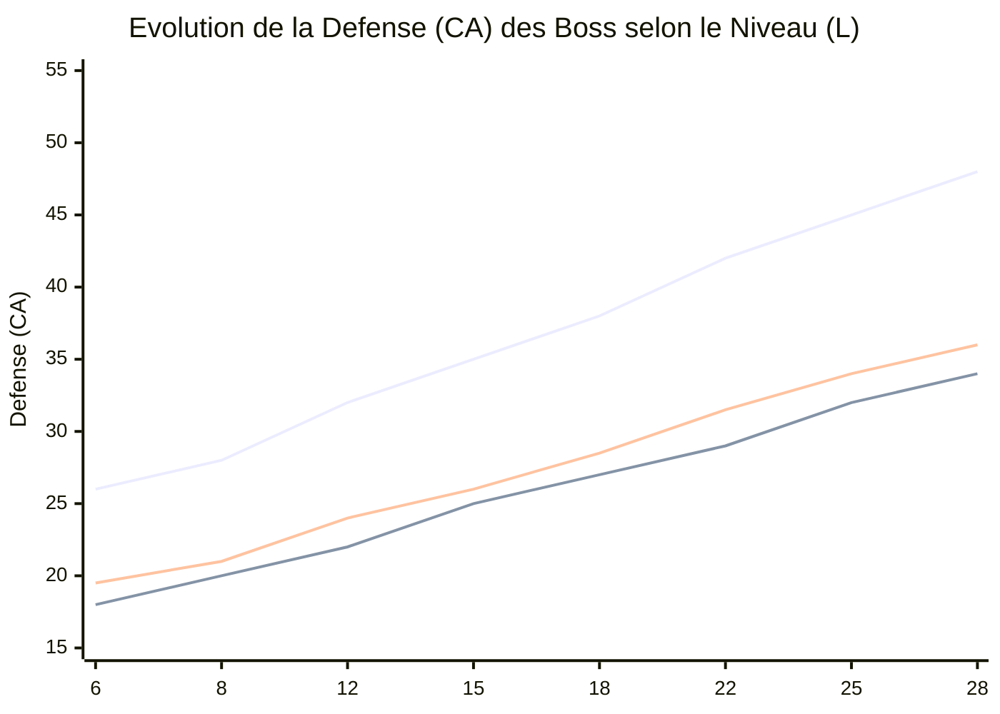

# Modèles Mathématiques & Courbes de Progression (*KotOR 2* vs *JdR Star Wars d20*)

Ce document définit les **fonctions mathématiques exactes** qui gouvernent les statistiques des ennemis et des boss en fonction du **niveau du joueur ($L$)** dans les deux systèmes :
1. **Système *KotOR 2*** : Basé sur les formules moteur de `autobalance.2da` (Paliers `Set_1` à `Set_5`) et les niveaux moyens auxquels le joueur affronte chaque boss.
2. **Système *JdR Papier Star Wars d20 (RCR)*** : Basé sur les formules de progression de classe (niveau 1 à 20).
3. **Simulateur de Dégâts par Round ($DPR$)** : Formule permettant de calculer instantanément l'impact de nos futurs équilibrages de dons et d'armes sur le temps nécessaire pour vaincre un boss (*Time-To-Kill*).

---

## Sommaire
1. [Niveau Moyen du Joueur par Zone et par Boss dans *KotOR 2*](#1-niveau-moyen-du-joueur-par-zone-et-par-boss-dans-kotor-2)
2. [Fonctions Mathématiques du Système *KotOR 2* (en fonction du niveau $L$)](#2-fonctions-mathématiques-du-système-kotor-2-en-fonction-du-niveau-l)
3. [Fonctions Mathématiques du JdR *Star Wars d20 (RCR)* (en fonction du niveau $L$)](#3-fonctions-mathématiques-du-jdr-star-wars-d20-rcr-en-fonction-du-niveau-l)
4. [Comparaison des Courbes Mathématiques : *KotOR 2* vs *JdR*](#4-comparaison-des-courbes-mathématiques--kotor-2-vs-jdr)
5. [Formule d'Impact pour nos Équilibrages ($DPR$ et *Time-To-Kill*)](#5-formule-dimpact-pour-nos-équilibrages-dpr-et-time-to-kill)

---

## 1. Niveau Moyen du Joueur par Zone et par Boss dans *KotOR 2*

Dans *KotOR 2*, les statistiques d'un ennemi sont figées au moment où l'Exilé entre dans la zone, en fonction de son **niveau actuel $L$** et du **`Set`** d'autobalance de l'ennemi (`Set_3` pour l'élite, `Set_4` pour les sous-boss, `Set_5` pour les boss majeurs).

Voici la progression moyenne du niveau $L$ du joueur au cours d'une campagne standard :

| Étape de la Campagne | Zone / Planète | Niveau Moyen ($L$) | Boss / Étalon Solo | Palier `autobalance.2da` |
| :--- | :--- | :---: | :--- | :---: |
| **1. Prologue / Début** | Péragus ➔ Citadelle de Telos | **$L = 6$** *(4 à 7)* | Mercenaires / Droïdes | `Set_1` / `Set_2` |
| **2. Académie Polaire** | Fin de Telos | **$L = 8$** *(8 à 9)* | **La Servante (Brianna)** (1v1 mains nues) | `Set_3` |
| **3. 1re Planète (Début)** | Ebon Hawk / Nar Shaddaa / Dantooine | **$L = 11$** *(10 à 12)* | **Visas Marr** (1v1 sabre) | `Set_4` |
| **4. 2e Planète (Milieu)** | Camp Mandalorien de Dxun | **$L = 15$** *(14 à 16)* | **Kelborn & Bralor** (1v1 mêlée sans Force) | `Set_4` |
| **5. 3e & 4e Planètes** | Onderon (1re visite) / Korriban | **$L = 19$** *(18 à 21)* | **Darth Sion** (Korriban) / Bêtes | `Set_5` |
| **6. Climax Planétaire** | Palais d'Onderon / Enclave de Dantooine | **$L = 22$** *(21 à 24)* | Général Vaklu / Maîtres Jedi | `Set_5` |
| **7. Retour à Telos** | Académie de Telos & *Le Ravageur* | **$L = 24$** *(23 à 25)* | **Atris** (1v1) & **Darth Nihilus** | `Set_5` |
| **8. Fin de Jeu (Endgame)** | Malachor V & Académie de Trayus | **$L = 28$** *(26 à 30)* | **Grande Bête d'Orage**, **Darth Sion**, **Darth Traya** | `Set_5` |

---

## 2. Fonctions Mathématiques du Système *KotOR 2* (en fonction du niveau $L$)

Soit **$L$** le niveau du personnage principal et un ennemi ayant des statistiques de base dans son fichier `.utc` ($VP_{base}, DEF_{base}, ATT_{base}, DMG_{base}, SAVE_{base}$) et appartenant à un palier **$S \in \{1..5\}$** de `autobalance.2da` :

| Paramètre `autobalance.2da` | `Set_1` (Sbire) | `Set_2` (Soldat) | `Set_3` (Élite) | `Set_4` (Lieutenant) | **`Set_5` (Boss Majeur)** |
| :--- | :---: | :---: | :---: | :---: | :---: |
| **$m_{vp}$ (`vpmult`)** | `0.65` | `0.65` | `0.65` | `0.70` | **`0.80`** |
| **$m_{att}$ (`tohitmult`)** | `0.90` | `0.90` | `0.95` | `1.00` | **`1.10`** |
| **$m_{def}$ (`armormult`)** | `0.60` | `0.70` | `0.80` | `0.90` | **`1.00`** |
| **$m_{dmg}$ (`damagemult`)** | `0.065` | `0.090` | `0.110` | `0.135` | **`0.175`** |
| **$m_{save}$ (`savemult`)** | `0.80` | `0.90` | `1.00` | `1.00` | **`1.05`** |
| **$m_{lvl}$ (`levelmult`)** | `0.75` | `0.75` | `0.75` | `0.75` | **`0.75`** |

### Les 5 Équations Moteur de *KotOR 2* :

1. **Niveau Effectif de l'Ennemi ($L_{eff}$ — utilisé pour le DD de ses pouvoirs et sa Résistance à la Force) :**
   $$L_{eff}(L) = L_{base} + \lfloor 0.75 \times L \rfloor - 1$$

2. **Points de Vie / Vitalité ($HP_{Kotor}$) :**
   $$HP_{Kotor}(L) = VP_{base} \times \max\left(\text{round}(m_{vp} \times L) - 1,\; 1\right)$$
   * *Pour un Boss Majeur (`Set_5`, $m_{vp} = 0.80$, $VP_{base} \approx 22$ à $50$) :*
     $$HP_{Boss}(L) \approx VP_{base} \times (0.80 \cdot L - 1)$$
     *(Ex: à $L = 28$, le multiplicateur de PV est de $\mathbf{\times 21.4}$ ! Un boss avec 55 PV de base passe à **1 180 PV**).*

3. **Défense ($DEF_{Kotor}$) :**
   $$DEF_{Kotor}(L) = DEF_{base} + \lfloor m_{def} \times L \rfloor + 2$$
   * *Pour un Boss Majeur (`Set_5`, $m_{def} = 1.00$, $DEF_{base} \approx 18$ à $21$) :*
     $$DEF_{Boss}(L) = 20 + 1.00 \cdot L$$
     *(Ex: $L = 8 \implies DEF \approx 28$ | $L = 22$ (Atris) $\implies DEF \approx 42\text{–}43$ | $L = 28$ (Traya) $\implies DEF \approx 48\text{–}51$).*

4. **Bonus d'Attaque ($ATT_{Kotor}$) :**
   $$ATT_{Kotor}(L) = ATT_{base} + \lfloor m_{att} \times L \rfloor$$
   * *Pour un Boss Majeur (`Set_5`, $m_{att} = 1.10$, $ATT_{base} \approx 10$) :*
     $$ATT_{Boss}(L) = 10 + 1.10 \cdot L$$
     *(Ex: $L = 8 \implies +19$ | $L = 15 \implies +26$ | $L = 28 \implies +41$).*

5. **Dégâts par Coup ($DMG_{Kotor}$) et Sauvegardes ($SAVE_{Kotor}$) :**
   $$DMG_{Kotor}(L) = DMG_{arme} \times \left(1 + \lceil m_{dmg} \cdot (L - 1) \rceil\right) + Bonus_{FOR}$$
   $$SAVE_{Kotor}(L) = SAVE_{base} + \lfloor m_{save} \times L \rfloor$$
   * *Pour un Boss Majeur (`Set_5`, $m_{save} = 1.05$) :*
     $$SAVE_{Boss}(L) \approx 8 + 1.05 \cdot L \quad (\text{+ Bonus de Caractéristique du Boss})$$

---

## 3. Fonctions Mathématiques du JdR *Star Wars d20 (RCR)* (en fonction du niveau $L$)

Dans le JdR papier ($L \in [1..20]$), il n'y a pas de multiplicateur artificiel : un boss de niveau $L$ suit exactement les formules mathématiques de construction de personnage :

1. **Santé Totale ($HP_{JdR} = VP + WP$) :**
   * Un boss martial/Jedi a un dé de vie moyen de $d10$ ($5.5$ PV/niv) + Mod. CON ($\approx +2$ à $+3$) + $WP$ ($CON \approx 15$) :
   $$HP_{JdR}(L) = 15 + 8.0 \cdot L$$
   *(Ex: $L = 6 \implies 63\text{ PV}$ | $L = 12 \implies 111\text{ PV}$ | $L = 18 \implies 159\text{ PV}$).*

2. **Défense ($DEF_{JdR}$) :**
   * $10 + \text{Bonus de Classe} (\approx 2 + 0.4 \cdot L) + \text{Mod. DEX} (\approx +3) + \text{Lightsaber Defense} (+2 \text{ à } +6)$ :
   $$DEF_{JdR}(L) = 15 + 0.75 \cdot L$$
   *(Ex: $L = 6 \implies 19.5$ | $L = 12 \implies 24\text{ à }28$ | $L = 18 \implies 28.5\text{ à }31$).*

3. **Bonus d'Attaque ($ATT_{JdR}$) :**
   * $\text{BBA Complet} (1.0 \cdot L) + \text{Mod. FOR/DEX} (+2 \text{ à } +4) + \text{Focus} (+1)$ :
   $$ATT_{JdR}(L) = 3 + 1.00 \cdot L$$
   *(Mais les attaques supplémentaires dans le round subissent **$-5 / -10 / -15$** !)*

4. **Dégâts par Coup au Sabre ($DMG_{JdR}$) :**
   * Le sabre gagne $+1d8$ ($4.5$ dégâts) tous les 4 niveaux à partir de $2d8$ ($9$), plus Mod. FOR ($\approx +3$) :
   $$DMG_{JdR}(L) = 9 + 1.125 \cdot L$$

5. **Jets de Sauvegarde ($SAVE_{JdR}$) :**
   * Progression forte ($2 + 0.5 \cdot L$) + Mod. Caractéristique ($\approx +2 + 0.1 \cdot L$) :
   $$SAVE_{JdR}(L) = 4 + 0.60 \cdot L$$

---

## 4. Comparaison des Courbes Mathématiques : *KotOR 2* vs *JdR*

Ce tableau résume côte à côte les fonctions de niveau $L$ pour un **Boss (`Set_5`)** et donne les valeurs numériques à chaque palier clé du jeu :

| Statistique du Boss | Fonction *JdR Star Wars d20* | Fonction *KotOR 2* (`Set_5`) | Niv. 8 *(Début)* | Niv. 15 *(Milieu)* | Niv. 22 *(Atris)* | Niv. 28 *(Traya/Fin)* |
| :--- | :--- | :--- | :---: | :---: | :---: | :---: |
| **Santé ($HP$)** | $15 + 8.0 \cdot L$ | $VP_{base} \cdot (0.8 \cdot L - 1)$ | 79 vs **95** | 135 vs **220** | 191 vs **450** | 239 vs **950+** |
| **Défense ($DEF$)** | $15 + 0.75 \cdot L$ | $20 + 1.00 \cdot L$ | 21 vs **28** | 26 vs **35** | 31 vs **42** | 36 vs **48–51** |
| **Attaque ($ATT$)** | $3 + 1.00 \cdot L$ | $10 + 1.10 \cdot L$ | +11 vs **+19** | +18 vs **+26** | +25 vs **+34** | +31 vs **+41** |
| **Dégâts / coup ($DMG$)** | $9 + 1.125 \cdot L$ | $DMG_0 \cdot (1 + 0.175 \cdot L) + FOR$ | 18 vs **16** | 26 vs **28** | 34 vs **42** | 40 vs **58** |
| **Sauvegarde ($SAVE$)** | $4 + 0.60 \cdot L$ | $8 + 1.05 \cdot L + Carac$ | +9 vs **+16** | +13 vs **+25** | +17 vs **+34** | +21 vs **+42 à +58** |

---

## 5. Formule d'Impact pour nos Équilibrages ($DPR$ et *Time-To-Kill*)

Grâce aux équations de *KotOR 2* ci-dessus, nous pouvons évaluer mathématiquement n'importe quel don ou arme que nous modifions au niveau **$L$** avec **3 formules directes** :

### 1. Probabilité de Toucher ($P_{hit}$) au Niveau $L$
Soit $ATT_{joueur}(L)$ le bonus d'attaque du joueur :
$$P_{hit}(L) = \text{clamp}\left(\frac{21 - \left(DEF_{ennemi}(L) - ATT_{joueur}(L)\right)}{20},\; 0.05,\; 0.95\right)$$
* **Impact d'un bonus d'attaque $+\Delta ATT$** (tant que $0.05 < P_{hit} < 0.95$) :
  $$\Delta P_{hit} = +5\% \text{ par point d'Attaque } (+0.05 \times \Delta ATT)$$
  * Contre un **Sbire `Set_2`** ($DEF(L) = 14 + 0.7 \cdot L$), un joueur atteint rapidement **95 % de chances de toucher** $\implies$ les bonus d'attaque supplémentaires ne servent plus à rien contre les sbires.
  * Contre un **Boss `Set_5`** ($DEF(L) = 20 + 1.0 \cdot L$), la Défense monte aussi vite que le BBA du joueur $\implies$ chaque point d'attaque (comme le `+1 / +2 / +3` de **Duel**) conserve sa pleine valeur de **+5 % à +15 % de précision** jusqu'au niveau 30 !

### 2. Dégâts Moyens par Round ($DPR$)
Pour un build effectuant **$N_{att}$** attaques par round, avec un dégât moyen par coup **$D_{coup}$**, une plage critique **$T_{crit}$** (ex: `19-20` $\implies \frac{2}{20} = 0.10$) et un multiplicateur critique **$M_{crit}$** (ex: $\times 2$) :
$$DPR(L) = N_{att} \times D_{coup} \times \left[ P_{hit}(L) + P_{hit}(L)^2 \cdot T_{crit} \cdot (M_{crit} - 1) \right]$$

### 3. Temps pour Tuer (*Time-To-Kill* — $TTK$ en rounds)
$$TTK(L) = \frac{HP_{ennemi}(L)}{DPR(L)}$$

> **Cibles d'équilibrage idéales pour nos futurs builds :**
> * **Contre un Sbire / Soldat (`Set_2`) au niveau $L$ :** $TTK$ cible = **1.0 à 1.5 round**.
> * **Contre un Boss Majeur (`Set_5`) au niveau $L$ :** $TTK$ cible = **4 à 6 rounds** (sans qu'un build ne descende sous 2 rounds ni ne dépasse 10 rounds).

### 4. Probabilité de Réussite d'un Effet à Jet de Sauvegarde (ex: Don *Stun Mains Nues*)
Pour qu'un don infligeant un étourdissement de difficulté **$DD(L)$** fonctionne contre un ennemi de sauvegarde $SAVE_{ennemi}(L)$ :
$$P_{stun}(L) = \text{clamp}\left(\frac{DD(L) - SAVE_{ennemi}(L) - 1}{20},\; 0.05,\; 0.95\right)$$
* Comme $SAVE_{ennemi}(L)$ dans KotOR 2 augmente de **$+1.00 \cdot L$** (pour les élites/sous-boss) à **$+1.05 \cdot L$** (pour les boss), **le $DD(L)$ de notre don DOIT impérativement avoir un coefficient de $1.0 \times L$** (c'est-à-dire $DD = 5 + 1.0 \cdot L + \text{Mod. Carac}$, exactement comme les pouvoirs de Force de KotOR 2), sinon $P_{stun}(L)$ tombera à **5 %** dès le milieu du jeu !
